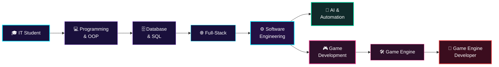

  

 

**นิสิตสาขาเทคโนโลยีสารสนเทศ · มหาวิทยาลัยเกษตรศาสตร์ 🇹🇭**

 

## 👋 สวัสดีครับ ผมนัท

ผมเป็นนิสิต IT ที่หลงใหลในเทคโนโลยี คอมพิวเตอร์ และโลกของเกม ตอนนี้กำลังหาเส้นทางของตัวเองในสายซอฟต์แวร์ ผ่านการลงมือเขียนโปรแกรมและสร้างระบบที่ใช้งานได้จริง

| 🎓 การศึกษา | 💻 ตอนนี้ | 🎯 เป้าหมาย |
|:---:|:---:|:---:|
| นิสิต IT มหาวิทยาลัยเกษตรศาสตร์ | เรียนรู้ & สร้างโปรเจกต์ | Software Engineer → Game Engine Developer |

 

## 🧭 กำลังโฟกัสอยู่ตอนนี้

| | หัวข้อ | รายละเอียด |
|:---:|:---|:---|
| 🐍 | **Programming** | พื้นฐานโปรแกรมมิ่ง · `Python` · `OOP` |
| 🗄️ | **Database** | การออกแบบฐานข้อมูล · `SQL` |
| 🌐 | **Web** | `Frontend` + `Backend` แบบ Full-Stack |
| 🤖 | **AI & Automation** | เชื่อมต่อ AI และสร้างระบบทำงานอัตโนมัติ |
| 🎮 | **Game Dev** | ศึกษาโครงสร้างเกมและ `Game Engine` เป็นเป้าหมายระยะยาว |

 

## 🧠 Tech Stack

**💻 ใช้งานอยู่**

  

**🔬 กำลังจะเรียนต่อ**

  

 

## 🚀 Projects

<table>
  <tr>
    <td width="33%" valign="top">
      <h3>💰 Personal Finance Dashboard</h3>
      
เว็บแอปบันทึกรายรับ-รายจ่าย ติดตามเงินออม และสรุปสถานะการเงินเป็นกราฟ

      <ul>
        <li>แยกหมวดหมู่รายรับ-รายจ่าย</li>
        <li>จัดการหลายบัญชี/กระเป๋าเงิน</li>
        <li>ติดตามเป้าหมายการออม-ลงทุน</li>
        <li>รายงานรายเดือนแบบ Data Viz</li>
      </ul>
      
<code>Python</code> <code>Database</code> <code>Web</code>

      
    </td>
    <td width="33%" valign="top">
      <h3>🤖 Paimon AI Assistant</h3>
      
ผู้ช่วยส่วนตัวพลัง AI แรงบันดาลใจจาก Paimon ใน Genshin Impact ช่วยจัดการชีวิตประจำวัน

      <ul>
        <li>ถาม-ตอบและค้นหาข้อมูลด้วย AI</li>
        <li>จัดการ To-do ประจำวัน</li>
        <li>แจ้งเตือนและทำงานอัตโนมัติ</li>
        <li>แดชบอร์ดรวมข้อมูลและนัดหมาย</li>
      </ul>
      
<code>Python</code> <code>AI</code> <code>Automation</code>

      
    </td>
    <td width="33%" valign="top">
      <h3>🌐 Developer Portfolio</h3>
      
เว็บไซต์รวมผลงาน ทักษะ และเส้นทางการเติบโตในสายนักพัฒนา

      <ul>
        <li>แนะนำตัวและเส้นทางการเรียนรู้</li>
        <li>แกลเลอรีโปรเจกต์พร้อมเดโม</li>
        <li>สถิติ GitHub แบบเรียลไทม์</li>
      </ul>
      
<code>HTML</code> <code>CSS</code> <code>JavaScript</code>

      
    </td>
  </tr>
</table>

> 📌 *ทุกโปรเจกต์อยู่ในขั้นออกแบบและวางแผน จะอัปเดตลิงก์ Repository เมื่อเริ่มลงมือเขียนโค้ดจริง*

 

## 📊 GitHub Analytics

<table>
  <tr>
    <td width="55%" align="center">
      
    </td>
    <td width="45%" align="center">
      
    </td>
  </tr>
  <tr>
    <td colspan="2" align="center">
      
    </td>
  </tr>
  <tr>
    <td colspan="2" align="center">
      
    </td>
  </tr>
</table>

 

## 🗺️ Career Roadmap

<b>🏁 เป้าหมายแต่ละช่วง (คลิกเพื่อดู)</b>

 

| ระยะ | เป้าหมาย |
|:---:|:---|
| **1** | **ปูพื้นฐาน** — สร้างโปรเจกต์ที่ใช้งานได้จริง และฝึกพื้นฐาน CS ให้แน่น |
| **2** | **เก็บประสบการณ์** — ฝึกงานสาย Software Development เรียนรู้การทำงานเป็นทีม |
| **3** | **ก้าวสู่มืออาชีพ** — เติบโตเป็น Software Engineer ที่ออกแบบระบบขนาดใหญ่ได้ |
| **4** | **เจาะลึกสายเกม** — `C++`, `Graphics Programming` และสถาปัตยกรรม `Game Engine` |

 

## 🎮 Beyond the Code

| | หมวดหมู่ | สิ่งที่สนใจ |
|:---:|:---|:---|
| 🎮 | **Gaming** | Genshin Impact · Monster Hunter · NBA 2K · เกมแนว RPG |
| 🖥️ | **Tech** | PC Hardware · สถาปัตยกรรมระบบ · Gaming Setup |
| 🎬 | **Creative** | Animation · ตัดต่อวิดีโอ · สร้างคอนเทนต์ |
| 🤖 | **Innovation** | AI · Automation · เทรนด์เทคโนโลยีใหม่ ๆ |
| 📈 | **Finance** | วางแผนการเงิน · การออม · การลงทุน |

 

