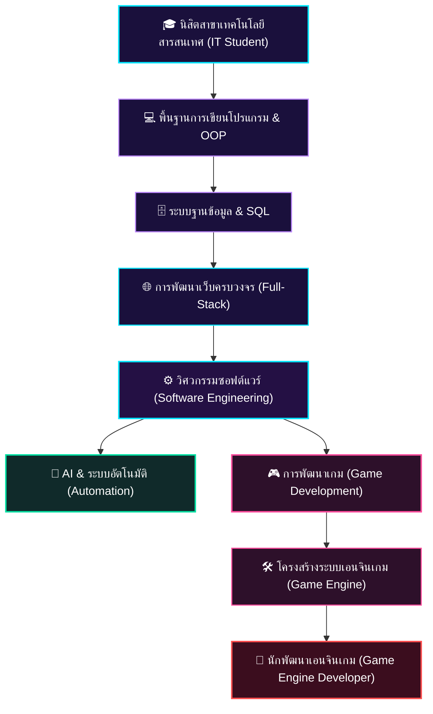

# 🌌 Nanthawat83 | CYBER DEVELOPER

 

**นิสิตสาขาเทคโนโลยีสารสนเทศ มหาวิทยาลัยเกษตรศาสตร์ 🇹🇭**

*สำรวจสิ่งที่ไม่เคยรู้ เรียนรู้สิ่งที่ท้าทาย และลงมือสร้างอนาคตด้วยโค้ด*

---

## 🖥️ 01 — ข้อมูลส่วนตัว (SYSTEM PROFILE)

### 📋 ข้อมูลพื้นฐาน

| หัวข้อ | รายละเอียด |
|:---|:---|
| **👤 ชื่อ / ชื่อเล่น** | นันทวัฒน์ (นัท / Nut) • `@Nanthawat83` |
| **📍 ที่อยู่** | ประเทศไทย 🇹🇭 |
| **🎓 การศึกษา** | นิสิตปริญญาตรี สาขาเทคโนโลยีสารสนเทศ (Information Technology) มหาวิทยาลัยเกษตรศาสตร์ |
| **💼 สถานะปัจจุบัน** | นิสิตสายไอที & กำลังฝึกฝนการพัฒนาซอฟต์แวร์ |
| **💡 ความสนใจหลัก** | Full-Stack Development, Software Engineering, AI, Game Development, อุตสาหกรรม Animation |
| **🎯 เป้าหมายระยะยาว** | Software Engineer & Game Engine Developer |
| **🔥 แนวคิดการทำงาน** | เรียนรู้และอัปเกรดตัวเองให้เก่งขึ้นในทุกวัน |

---

### 👋 แนะนำตัว (About Me)

สวัสดีครับ ผมชื่อ **นัท (Nut)** ปัจจุบันกำลังศึกษาอยู่สาขาเทคโนโลยีสารสนเทศ มหาวิทยาลัยเกษตรศาสตร์

ผมเป็นคนที่หลงใหลในเทคโนโลยี คอมพิวเตอร์ และโลกของเกม ตอนนี้กำลังเรียนรู้และค้นหาเส้นทางของตัวเองในสายงาน IT โดยเฉพาะการพัฒนาซอฟต์แวร์และการสร้างสรรค์สิ่งใหม่ ๆ ผ่านการเขียนโปรแกรม

ผมให้ความสนใจกับการพัฒนา **Web Applications**, **Full-Stack Development** และการนำ **AI** มาประยุกต์ใช้แก้ปัญหาในชีวิตประจำวัน รวมถึงการออกแบบระบบที่สามารถนำไปใช้งานได้จริง

นอกจากสายงานซอฟต์แวร์ทั่วไปแล้ว ผมยังมีความฝันที่จะได้ก้าวเข้าสู่อุตสาหกรรมเกม ไม่ว่าจะเป็น **Game Development**, **Game Engine Development** หรือเทคโนโลยีเบื้องหลังงาน **Animation** และ Digital Content

สำหรับผม การเขียนโปรแกรมไม่ใช่แค่การพิมพ์คำสั่งให้คอมพิวเตอร์ทำงาน แต่คือการใช้ความคิดสร้างสรรค์และการแก้ปัญหา เพื่อสร้างประสบการณ์ใหม่ ๆ ที่น่าจดจำให้กับผู้ใช้งาน

> *"ไม่จำเป็นต้องรู้ทุกอย่างตั้งแต่วันนี้ ขอแค่เก่งขึ้นกว่าเมื่อวานก็พอ"*

---

## ⚡ 02 — ศูนย์ควบคุมและเป้าหมาย (DEVELOPER CONTROL CENTER)

| 🎓 การศึกษา | 💻 สถานะปัจจุบัน | 🎯 เป้าหมายปลายทาง |
|:---:|:---:|:---:|
| นิสิตสาขา IT | เรียนรู้ & สร้างโปรเจกต์ | Game Engine Developer |
| มหาวิทยาลัยเกษตรศาสตร์ | ฝึกฝนทักษะการเขียนโค้ด | Software Engineer |

### 🧭 สิ่งที่กำลังโฟกัสในตอนนี้

| หมวดหมู่ | แนวทางที่กำลังเรียนรู้ |
|:---|:---|
| **Programming** | พื้นฐานการเขียนโปรแกรมและภาษา `Python` |
| **Software** | การเขียนโปรแกรมเชิงวัตถุ (`Object-Oriented Programming`) |
| **Database** | การออกแบบและจัดการฐานข้อมูล (`Database & SQL`) |
| **Web** | การพัฒนาเว็บไซต์ทั้งส่วนหน้าบ้านและหลังบ้าน (`Frontend & Backend`) |
| **AI** | การเชื่อมต่อ `AI` และสร้างระบบทำงานอัตโนมัติ (`Automation`) |
| **Career** | เตรียมความพร้อมสู่สายงาน `Full-Stack` และ `Software Engineering` |

### 🎯 ภารกิจสายอาชีพ (Career Mission)

1. **Full-Stack Developer** — พัฒนาเว็บแอปพลิเคชันแบบครบวงจรทั้งหน้าบ้านและหลังบ้าน
2. **Software Engineering** — ออกแบบโครงสร้างซอฟต์แวร์ที่เป็นระบบ เสถียร และต่อยอดได้ง่าย
3. **Game Development** — สร้างสรรค์เกมและออกแบบระบบการเล่นที่สนุกและมีเอกลักษณ์
4. **AI & Automation** — นำปัญญาประดิษฐ์มาช่วยทุ่นแรงและเพิ่มประสิทธิภาพการทำงานในชีวิตจริง
5. **Animation Industry** — ศึกษาเทคโนโลยีและเครื่องมือเบื้องหลังการผลิตแอนิเมชันและสื่อดิจิทัล
6. **Game Engine Developer** — เจาะลึกระบบเอนจินและโครงสร้างพื้นฐานที่เป็นหัวใจของการสร้างเกม

---

## 🧠 03 — คลังทักษะและเครื่องมือ (SKILL MATRIX)

*ทักษะและเทคโนโลยีเหล่านี้กำลังเติบโตขึ้นตามประสบการณ์และโปรเจกต์ที่ผมได้ลงมือทำ*

| หมวดหมู่ | ทักษะและเครื่องมือที่ใช้ |
|:---|:---|
| **💻 ภาษาโปรแกรม (Languages)** | `Python` • `JavaScript` • `HTML5` • `CSS3` |
| **🌐 เฟรมเวิร์กและไลบรารี (Frameworks)** | `React` • `Node.js` • `Tailwind CSS` |
| **🗄️ เครื่องมือและสภาพแวดล้อม (Tools)** | `Git` • `GitHub` • `VS Code` • `DaVinci Resolve` • `OBS Studio` |
| **🔬 เทคโนโลยีที่สนใจศึกษาต่อ (Exploring)** | `TypeScript` • `Docker` • `PostgreSQL` • `C++` • `Unity` • `Unreal Engine` |

---

## 🚀 04 — ห้องทดลองโปรเจกต์ (PROJECT LABORATORY)

*เปลี่ยนไอเดียให้เป็นโปรเจกต์ และเปลี่ยนโปรเจกต์ให้เป็นประสบการณ์จริง*

### 💰 PROJECT 001 — PERSONAL FINANCE DASHBOARD

**ระบบจัดการและวิเคราะห์การเงินส่วนบุคคล**

โปรเจกต์เว็บแอปพลิเคชันสำหรับใช้บันทึกรายรับ-รายจ่าย ติดตามเงินออม และวิเคราะห์สถานะทางการเงินของตัวเองให้ง่ายต่อการวางแผน

* **ฟีเจอร์ที่วางแผนไว้:**
  * บันทึกและแยกหมวดหมู่รายรับ-รายจ่ายประจำวัน
  * จัดการบัญชีและกระเป๋าเงินหลายรูปแบบ
  * ติดตามเป้าหมายการออมและการลงทุน
  * สรุปรายงานการเงินรายเดือนในรูปแบบกราฟ (`Data Visualization`)
* **เทคโนโลยีที่ใช้:** `Python` `Database` `Web Development` `Data Visualization`

---

### 🤖 PROJECT 002 — PAIMON AI ASSISTANT

**ผู้ช่วยอัจฉริยะส่วนตัวพลัง AI**

โปรเจกต์ที่ได้รับแรงบันดาลใจจากตัวละคร Paimon ในเกม Genshin Impact โดยตั้งใจนำ `AI` มาช่วยจัดการตารางชีวิตและงานประจำวันให้สะดวกขึ้น

* **ฟีเจอร์ที่วางแผนไว้:**
  * ระบบผู้ช่วยโต้ตอบและช่วยค้นหาข้อมูลด้วย AI
  * จัดการรายการสิ่งที่ต้องทำ (`Daily Task Management`)
  * ระบบแจ้งเตือนและทำงานอัตโนมัติ (`Smart Automation`)
  * หน้าแดชบอร์ดรวบรวมข้อมูลส่วนตัวและการนัดหมาย
* **เทคโนโลยีที่ใช้:** `Python` `AI` `Automation` `Web Application`

---

### 🌐 PROJECT 003 — DEVELOPER PORTFOLIO

**เว็บไซต์รวบรวมผลงานและโปรไฟล์นักพัฒนา**

พื้นที่ออนไลน์สำหรับจัดแสดงผลงาน ทักษะ และบันทึกเส้นทางการเติบโตของตัวเองในสายงาน Software Developer

* **ฟีเจอร์ที่วางแผนไว้:**
  * หน้าแนะนำตัวและเล่าเรื่องราวเส้นทางการเรียนรู้
  * แกลเลอรีจัดแสดงโปรเจกต์พร้อมตัวอย่างการทำงาน
  * แสดงสถิติการเขียนโค้ดจาก GitHub แบบเรียลไทม์
* **เทคโนโลยีที่ใช้:** `HTML` `CSS` `JavaScript` `GitHub`

> **สถานะปัจจุบัน:** *โปรเจกต์ทั้งหมดอยู่ในขั้นตอนการออกแบบและวางแผนพัฒนา จะอัปเดตลิงก์ Repository และรายละเอียดเพิ่มเติมเมื่อเริ่มลงมือเขียนโค้ดจริงครับ*

---

## 📊 05 — สถิติการเขียนโค้ด (GITHUB ANALYTICS)

### ภาพรวมการทำงานและภาษาที่ใช้บ่อย

  
  

### ความต่อเนื่องในการเขียนโค้ด (CONTRIBUTION STREAK)

### รางวัลความสำเร็จ (GITHUB TROPHIES)

### กราฟความเคลื่อนไหว (CONTRIBUTION GRAPH)

---

## 🗺️ 06 — แผนที่เส้นทางอาชีพ (CAREER ROADMAP)

### เส้นทางการเติบโตจากนิสิตไอที สู่สายงาน Software & Game Engineering

### 🏁 เป้าหมายสำคัญในแต่ละช่วง (Long-Term Milestones)

* **ระยะที่ 1 — ปูพื้นฐานให้แน่น:** สร้างโปรเจกต์ซอฟต์แวร์ที่ใช้งานได้จริง และฝึกฝนพื้นฐานวิทยาการคอมพิวเตอร์ให้แข็งแรง
* **ระยะที่ 2 — เก็บเกี่ยวประสบการณ์จริง:** มองหาโอกาสฝึกงาน (`Internship`) ในสายงาน Software Development เพื่อเรียนรู้การทำงานร่วมกับทีมมืออาชีพ
* **ระยะที่ 3 — ก้าวสู่มืออาชีพ:** เติบโตเป็น `Software Engineer` ที่สามารถออกแบบและพัฒนาระบบขนาดใหญ่ได้
* **ระยะที่ 4 — เจาะลึกสายเกม:** ศึกษาภาษา `C++`, `Graphics Programming` และสถาปัตยกรรม `Game Engine` เพื่อก้าวเข้าสู่อุตสาหกรรมเกมหรือแอนิเมชันอย่างเต็มตัว

---

## 🎮 07 — โลกนอกเหนือจากโค้ด (BEYOND THE CODE)

**นักพัฒนาซอฟต์แวร์ไม่ได้มีแค่เรื่องโค้ด แต่ยังมีแรงบันดาลใจจากสิ่งรอบตัว**

| หมวดหมู่ | สิ่งที่สนใจและงานอดิเรก |
|:---|:---|
| **🎮 เกม (Gaming)** | Genshin Impact, Monster Hunter, NBA 2K, เกมแนว RPG |
| **🖥️ เทคโนโลยี (Tech)** | อุปกรณ์คอมพิวเตอร์ (PC Hardware), สถาปัตยกรรมระบบ, การจัดโต๊ะคอม (Gaming Setup) |
| **🎬 งานสร้างสรรค์ (Creative)** | งานแอนิเมชัน (Animation), การตัดต่อวิดีโอ, การสร้างคอนเทนต์ |
| **🤖 นวัตกรรม (Innovation)** | เทคโนโลยี AI, ระบบอัตโนมัติ และเทรนด์เทคโนโลยีใหม่ ๆ |
| **📈 การเงิน (Finance)** | การวางแผนการเงินส่วนบุคคล, การออม และการลงทุน |

### 🎯 สิ่งที่จุดประกายแรงบันดาลใจ

* โลกในเกมและเบื้องหลังทางวิศวกรรมที่ทำให้เกมเหล่านั้นมีชีวิตขึ้นมา
* การเล่าเรื่องผ่านงานภาพและแอนิเมชันที่สร้างสรรค์
* การประกอบและปรับแต่งฮาร์ดแวร์คอมพิวเตอร์ให้ทำงานได้เต็มประสิทธิภาพ
* การสร้างแอปพลิเคชันที่ช่วยแก้ปัญหาในชีวิตประจำวันได้จริง

---

## 📡 08 — ช่องทางติดต่อ (CONNECT WITH ME)

**ยินดีที่ได้รู้จักครับ! สามารถพูดคุย แลกเปลี่ยนความรู้ หรือร่วมทำโปรเจกต์ด้วยกันได้เสมอ**

**อีเมลติดต่อ:** `Nanthawat.chu@ku.th`

---

## ⚡ END OF TRANSMISSION

**เรียนรู้ต่อไป ลงมือสร้างต่อไป และไม่หยุดสำรวจสิ่งใหม่**

*โค้ดทุกบรรทัดที่เขียนในวันนี้ คือก้าวสำคัญสู่อนาคต*

