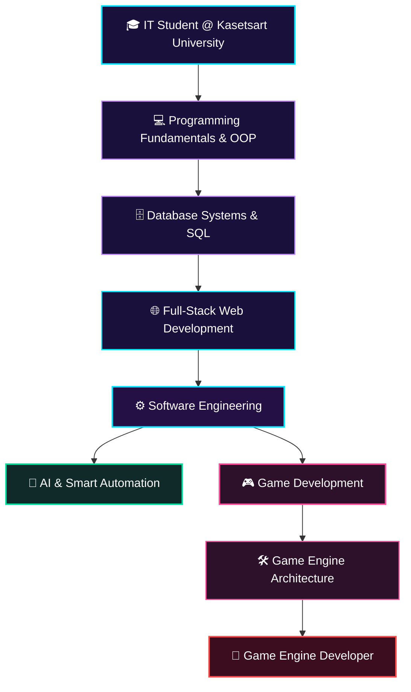

# 🌌 Nanthawat83 | CYBER DEVELOPER

 

**IT STUDENT @ KASETSART UNIVERSITY 🇹🇭**

*Explore the unknown. Learn the impossible. Build the future.*

---

# `[ SYSTEM INITIALIZED ]`

**WELCOME TO MY DIGITAL SPACE**

## 🖥️ 01 — SYSTEM PROFILE

### 📋 Identity & Overview

| หัวข้อ (Attribute) | รายละเอียด (Details) |
|:---|:---|
| **👤 Name / Alias** | Nanthawat (Nut / นัท) • `@Nanthawat83` |
| **📍 Location** | Thailand 🇹🇭 |
| **🎓 Education** | Undergraduate Student in **Information Technology**, Kasetsart University |
| **💼 Current Role** | IT Student & Aspiring Software Developer |
| **💡 Primary Interests** | Full-Stack Development, Software Engineering, Artificial Intelligence, Game Development, Animation Industry |
| **🎯 Long-Term Goals** | Software Engineer & Game Engine Developer |
| **🔥 Mindset** | *Always Learning & Improving* |

---

### 👋 About Me | เกี่ยวกับฉัน

สวัสดีครับ ผมชื่อ **Nut (นัท)** เป็นนักศึกษาสาขาเทคโนโลยีสารสนเทศ มหาวิทยาลัยเกษตรศาสตร์

ผมเป็นคนที่ชื่นชอบเทคโนโลยี คอมพิวเตอร์ และเกม ปัจจุบันกำลังเรียนรู้และค้นหาเส้นทางของตัวเองในสายงาน IT โดยเฉพาะการพัฒนาซอฟต์แวร์และการสร้างสิ่งใหม่ ๆ ด้วย Programming

ผมสนใจการพัฒนา Web Applications, Full-Stack Development และการนำ AI มาใช้แก้ปัญหาในชีวิตประจำวัน รวมถึงการออกแบบระบบที่สามารถนำไปใช้งานได้จริง

นอกจากสาย Software แล้ว ผมยังมีความฝันที่จะได้ทำงานในอุตสาหกรรมเกม ไม่ว่าจะเป็น Game Development, Game Engine Development หรือเทคโนโลยีเบื้องหลัง Animation และ Digital Content

สำหรับผม การเขียนโปรแกรมไม่ใช่เพียงการเขียนคำสั่งให้คอมพิวเตอร์ทำงาน แต่เป็นการใช้ความคิดสร้างสรรค์และการแก้ปัญหาเพื่อสร้างประสบการณ์ใหม่ ๆ ให้กับผู้คน

> *"I don't need to know everything today. I just need to be better than yesterday."*

---

## ⚡ 02 — DEVELOPER CONTROL CENTER

| 🎓 EDUCATION | 💻 CURRENT STATUS | 🎯 DESTINATION |
|:---:|:---:|:---:|
| IT Student | Learning & Building | Game Engine Developer |
| Kasetsart University | Personal Projects | Software Engineer |

### 🧭 Current Focus

| Category | Current Direction |
|:---|:---|
| **Programming** | Python & Programming Fundamentals |
| **Software** | Object-Oriented Programming (OOP) |
| **Database** | Database Management & SQL |
| **Web** | Frontend & Backend Development |
| **AI** | AI Integration & Automation |
| **Career** | Full-Stack / Software Engineering |

### 🎯 Career Mission

1. **Full-Stack Developer** — พัฒนาเว็บแอปพลิเคชันแบบครบวงจรทั้งหน้าบ้านและหลังบ้าน
2. **Software Engineering** — ออกแบบสถาปัตยกรรมซอฟต์แวร์ที่เป็นระบบและขยายต่อได้
3. **Game Development** — สร้างสรรค์เกมและระบบการเล่นที่น่าสนใจ
4. **AI & Automation** — ประยุกต์ใช้ปัญญาประดิษฐ์และระบบอัตโนมัติในงานจริง
5. **Animation Industry** — ศึกษาเทคโนโลยีเบื้องหลังงานแอนิเมชันและดิจิทัลคอนเทนต์
6. **Game Engine Developer** — พัฒนาระบบเอนจินและเครื่องมือหลักสำหรับการสร้างเกม

---

## 🧠 03 — SKILL MATRIX

*My technology stack is evolving as I learn and build more projects.*

| หมวดหมู่ (Category) | ทักษะและเครื่องมือ (Skills & Tools) |
|:---|:---|
| **💻 Programming Languages** | `Python` • `JavaScript` • `HTML5` • `CSS3` |
| **🌐 Frameworks & Libraries** | `React` • `Node.js` • `Tailwind CSS` |
| **🗄️ Tools & Environment** | `Git` • `GitHub` • `VS Code` • `DaVinci Resolve` • `OBS Studio` |
| **🔬 Exploring Next** | `TypeScript` • `Docker` • `PostgreSQL` • `C++` • `Unity` • `Unreal Engine` |

---

## 🚀 04 — PROJECT LABORATORY

*Ideas become projects. Projects become experience.*

### 💰 PROJECT 001 — PERSONAL FINANCE DASHBOARD

**Personal Financial Management System**

ระบบจัดการการเงินส่วนบุคคลที่ต้องการพัฒนาขึ้นเพื่อใช้ติดตามและวิเคราะห์สถานะทางการเงินของตัวเอง

* **Planned Features:**
  * Income & Expense Tracking
  * Wallet and Account Management
  * Savings & Investment Tracking
  * Monthly Financial Reports
  * Interactive Dashboard & Data Visualization
* **Tech Stack:** `Python` `Database` `Web Development` `Data Visualization`

---

### 🤖 PROJECT 002 — PAIMON AI ASSISTANT

**AI-Powered Personal Assistant**

แนวคิดผู้ช่วยอัจฉริยะที่ได้รับแรงบันดาลใจจาก Paimon ใน Genshin Impact โดยต้องการนำ AI มาประยุกต์ใช้กับชีวิตประจำวัน

* **Planned Features:**
  * AI Personal Assistant
  * Daily Task Management
  * Smart Automation
  * Personal Information Management
  * Productivity Dashboard
* **Tech Stack:** `Python` `AI` `Automation` `Web Application`

---

### 🌐 PROJECT 003 — DEVELOPER PORTFOLIO

**Personal Developer Portfolio**

พื้นที่รวบรวมผลงาน ความสามารถ และพัฒนาการของตัวเองในเส้นทาง Developer

* **Planned Features:**
  * Personal Introduction & Project Showcase
  * Developer Dashboard
  * Technology Stack & GitHub Analytics
* **Tech Stack:** `HTML` `CSS` `JavaScript` `GitHub`

> **Status:** *Idea & Planning — Repository links and implementation details will be added as development progresses.*

---

## 📊 05 — GITHUB ANALYTICS

### SYSTEM PERFORMANCE

### LANGUAGE DISTRIBUTION

### CONTRIBUTION STREAK

### GITHUB TROPHIES

### CONTRIBUTION GRAPH

---

## 🗺️ 06 — CAREER ROADMAP

### FROM STUDENT TO SOFTWARE & GAME ENGINEER

### 🏁 Long-Term Milestones

* **Phase 1 — Foundation:** Build practical software projects and strengthen core computer science skills.
* **Phase 2 — Experience:** Gain real-world development experience through Software Development internships.
* **Phase 3 — Career:** Become a professional Software Engineer capable of building scalable systems.
* **Phase 4 — Specialization:** Dive deep into C++, graphics programming, and Game Engine Development to work in the Game or Animation Industry.

---

## 🎮 07 — BEYOND THE CODE

**A developer is more than just code.**

| Category | My Interests |
|:---|:---|
| **🎮 Gaming** | Genshin Impact, Monster Hunter, NBA 2K, RPG |
| **🖥️ Technology** | PC Hardware, Computer Systems, Gaming Setup |
| **🎬 Creative** | Animation, Video Editing, Content Creation |
| **🤖 Innovation** | AI, Automation, New Technologies |
| **📈 Finance** | Personal Finance, Saving, Investing |

### 🎯 What Inspires Me

* Game worlds and the engineering behind them.
* Creative storytelling and animation.
* Computer hardware and system architecture.
* Building applications that solve real problems.
* Learning how complex software systems work.

---

## 📡 08 — CONNECT WITH ME

**LET'S LEARN, BUILD AND CREATE SOMETHING GREAT.**

**Email:** `Nanthawat.chu@ku.th`

---

## ⚡ END OF TRANSMISSION

**KEEP LEARNING. KEEP BUILDING. KEEP EXPLORING.**

*Every line of code is another step toward the future.*

